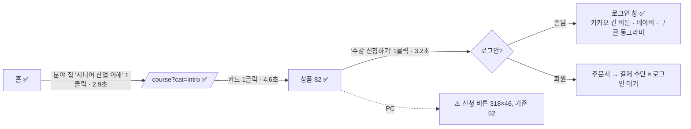
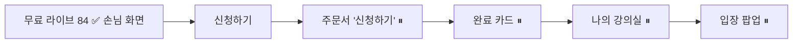
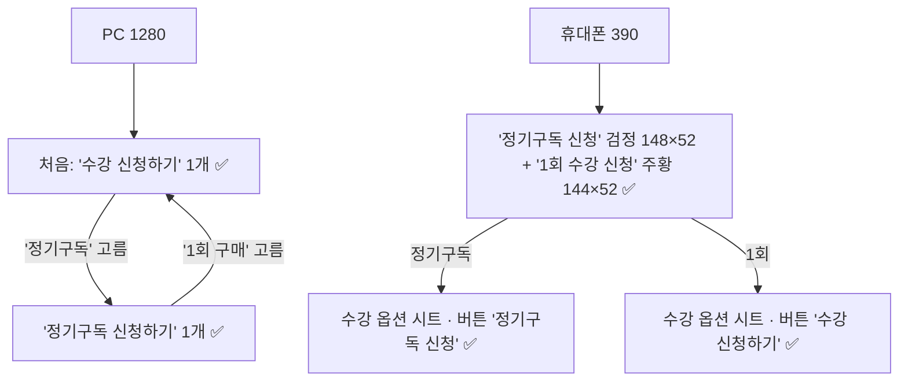
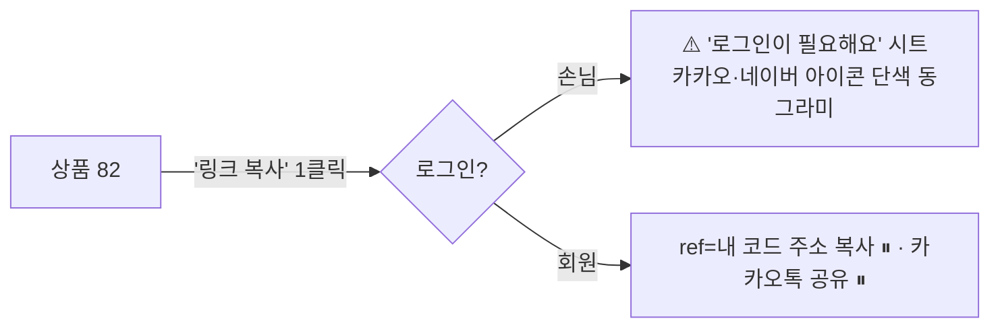
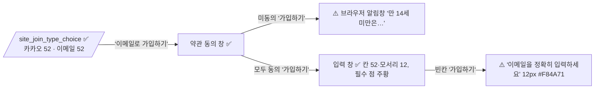
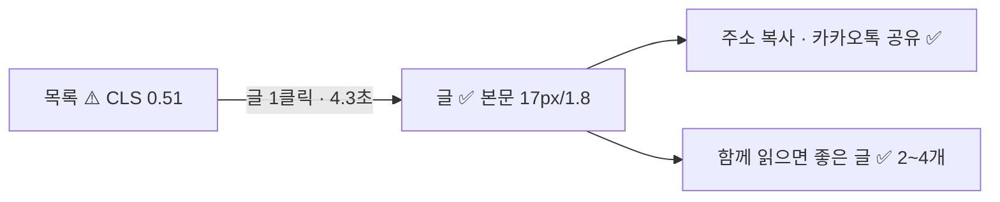
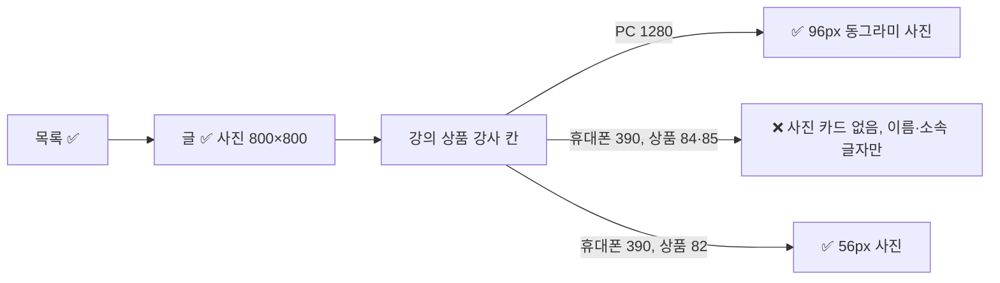
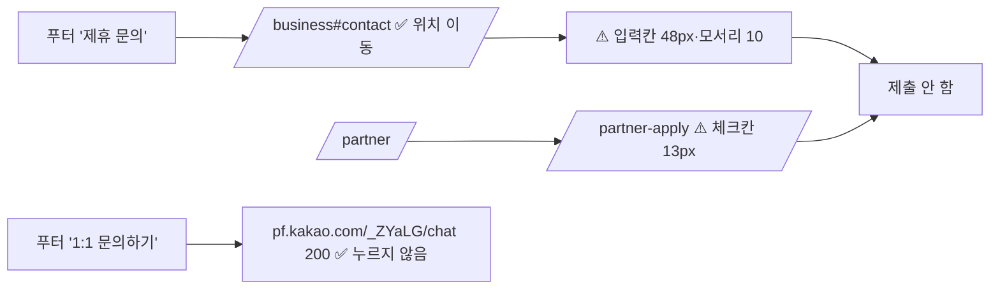

# 05. UX 흐름도 (11/2 밤, 운영 v1.0.199, 손님 화면)

- 잰 방법: Playwright(크롬) 휴대폰 390(아이폰 UA)·PC 1280, 실제 망(느리게 하지 않음). 걸린 시간 = 첫 화면 열린 뒤부터 단계 끝까지.
- 안전: 카카오 공유·채널·결제 회사 주소로 가는 요청은 막고(주소만 기록), 결제·가입 완료·제출 버튼은 누르지 않음.
- 캡처: `05-흐름캡처/`
- (11/3 추가) 로그인 흐름 2·4·5·6 은 앱 브라우저의 관리자 로그인(`seniorfuture.imweb.me` 주소 — `.kr` 주소와 로그인이 따로임)으로 휴대폰 375 에서 읽기만 함. 앱 브라우저 창을 **보이게 둔 상태**로 잼(창이 가려지면 rAF 가 멈춰 거짓 실패가 남 — 실제로 적립금 탭에서 한 번 겪고 다시 잼). 실제 신청·주문서 열기는 하지 않음 → `07-확인못함.md`

| 흐름 | 결과 | 클릭 | 걸린 시간 | 막힌 곳·메모 |
|---|---|---|---|---|
| 1 손님 신청 | ✅ (결제 화면은 로그인 필요) | 3 | 390 12.1초 / 1280 13.2초 | PC '수강 신청하기' 46px(기준 52) |
| 2 회원 무료 신청 | ⚠️ 일부 | - | - | 신청·완료 카드는 시험 신청을 안 해서 못 봄(07). 나의 강의실 ✅: 카드 12개, D-day 가 '일시' 바로 옆(11px), 상태 색 신청 완료 주황 #E05A00 · 참여 예정 보라 #6941E0 · 개강 전 파랑, CLS 0. 강의실 입장 → /class?idx=82 정상. 입장 버튼 40px·모서리 10 |
| 3 멤버십 103 | ✅ | 1~2 | 2~3초 | 시트 버튼 문구는 '정기구독 신청'/'수강 신청하기'(휴대폰 아래 버튼 '1회 수강 신청'과 문구 다름) |
| 4 공유 | ⚠️ | 1 | 1.5초 | 회원: '링크 복사' → 상품 주소 + utm_* + 
ef=내 코드 ✅, '링크 복사 완료' 창에 '카카오톡으로 바로 보내기'(44px) 있음(누르지 않음). 손님은 '로그인이 필요해요' 시트(정상). 시트 안 카카오·네이버 아이콘이 로고 없이 단색 동그라미, 버튼 모서리 10px |
| 5 링크 생성하기 | ✅ | 1 | 0.5초 | 강의별 '링크 복사' 2개 → /course/?idx=103&ref=…, /course/?idx=82&ref=… (상품 주소, 마이페이지 주소 아님). 버튼 36px |
| 6 마이페이지 전체 | ✅(작은 터치만 ⚠️) | - | - | 결제 내역·적립금: 0.05초 간격으로 봐도 아임웹 기본 화면 안 보임(우리 화면 0.67~0.83초에 뜸), CLS 0~0.027. 찜·열람 빈 카드 345×245 모서리 16 ✅, 열람은 상품 본 뒤 바로 1개 나옴 ✅. 쿠폰 1장 카드 ✅(0장 빈 카드는 계정에 쿠폰이 있어 못 봄). 적립금 내역 10줄 ✅. 프로필 사진: 관리자 계정이 카카오 연결 없음 → 못 봄. 탭 37px·칩 34px 등 44 미만. 로그아웃 상태에서 `/shop_mypage/?sf=room` → 로그인 화면, 돌아갈 주소가 `/shop_mypage/?m2=order`(결제 내역)로 바뀜 |
| 7 회원가입 창 | ⚠️ | 3 | 약 10초 | 칸 52px·모서리 12 ✅, 필수 점 주황 ✅. 빈칸 제출 오류 문구 12px·분홍(#F84A71) 대비 3.4:1(기준 4.5). 약관 미동의 시 브라우저 기본 알림창 |
| 8 인사이트 | ⚠️ | 1 | 4.3~4.9초 | 글·공유(주소 복사·카카오톡)·관련 글 ✅. 목록 화면 첫 그림 뒤 큰 밀림(CLS 390 0.51 / 1280 0.19) |
| 9 전문가 | ⚠️ | 2 | 10초 | 글 사진 800×800·동그라미 아님(16px 모서리)·얼굴 위치 50% 30% ✅. 휴대폰 상품 84·85 강사(연사·호스트) 사진 카드가 없음(PC 는 있음) |
| 10 기업 문의·파트너 지원 | ⚠️ | 0~1 | - | `#contact` 위치로 이동 ✅. 입력칸 48px·모서리 10px(기준 52/12), 파트너 지원 동의 체크칸 13px |
| 11 고객 지원 | ✅ | 0 | - | 링크 32개 응답 200(누르지 않음). 카카오 채널 링크는 누를 때 리퍼러 안 넘김 설정됨 |

## 1. 손님: 홈 → 교육 분야 → 상품 82 → 수강 신청 → 로그인 창

## 2. 회원: 무료 라이브 → 신청 → 완료 카드 → 나의 강의실 (⏸)

## 3. 멤버십 103

## 4. 공유

## 7. 회원가입 창

## 8. 인사이트

## 9. 전문가

## 10·11. 문의·지원

